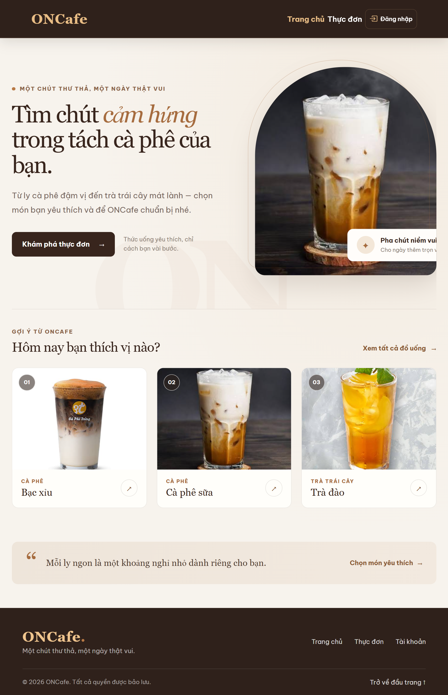
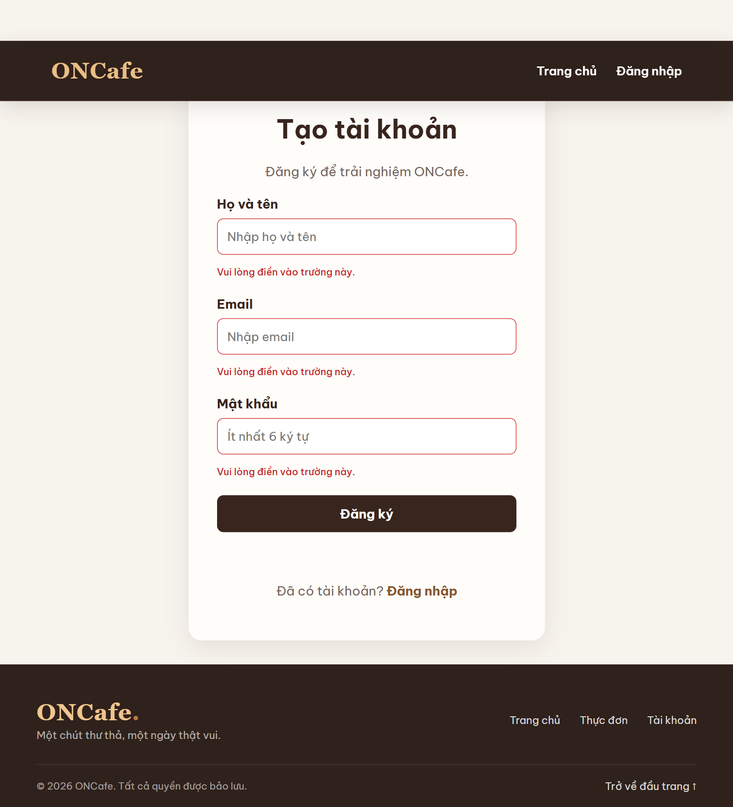
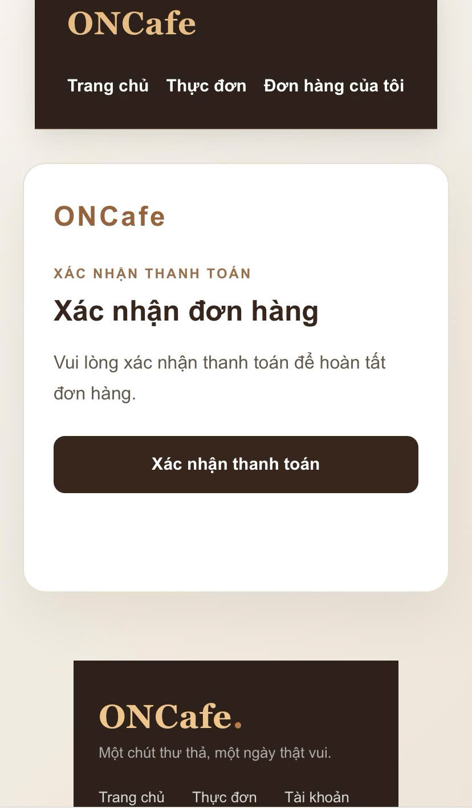

# ONCafe – Hệ thống quản lý quán cà phê và đồ uống

ONCafe là ứng dụng web hỗ trợ quản lý hoạt động của một quán cà phê/đồ uống. Hệ thống có hai khu vực chính: khu vực khách hàng để xem thực đơn và đặt hàng; khu vực nhân viên để quản lý đồ uống, đơn hàng, bán hàng tại quầy và theo dõi doanh thu.

Dự án được xây dựng bằng HTML, CSS và JavaScript ES Modules. Frontend tĩnh nằm trong `public/onCafe/`; dữ liệu, xác thực và các nghiệp vụ phía máy chủ sử dụng Supabase.

> **Trạng thái dự án:** Mã nguồn frontend và các migration/Edge Functions của Supabase được lưu trong repository. Để vận hành ứng dụng cần cấu hình dự án Supabase, áp dụng migration và triển khai các Edge Functions tương ứng.

## Giao diện

Các ảnh dưới đây được trích nguyên bản từ báo cáo đồ án:

<table>
  <tr>
    <td align="center"> Trang chủ khách hàng</td>
    <td align="center"> Đăng ký và kiểm tra dữ liệu đầu vào</td>
    <td align="center"> Xác nhận đơn hàng trên điện thoại</td>
  </tr>
</table>

## 1. Mục tiêu

- Hỗ trợ khách hàng xem thực đơn và gửi đơn đặt đồ uống trực tuyến.
- Hỗ trợ nhân viên tiếp nhận, theo dõi và xử lý đơn hàng.
- Quản lý danh mục đồ uống, giá bán, hình ảnh và số lượng tồn kho.
- Hỗ trợ bán hàng trực tiếp tại quầy.
- Phân chia quyền truy cập theo vai trò người dùng.
- Tổng hợp doanh thu, tình hình thanh toán và sản phẩm bán chạy.

## 2. Đối tượng sử dụng và phân quyền

Hệ thống sử dụng các vai trò lưu trong bảng hồ sơ người dùng (profiles).

| Vai trò | Quyền và chức năng chính |
|---|---|
| **Admin – Quản trị viên** | Truy cập tổng quan; quản lý đồ uống; quản lý tài khoản nhân viên; tạo đơn tại quầy; quản lý đơn hàng; xem tổng hợp và báo cáo doanh thu; xem đồ uống bán chạy; quản lý thông tin cá nhân. |
| **Seller – Nhân viên bán hàng** | Xem tổng quan bán hàng; quản lý đồ uống; tạo đơn tại quầy; theo dõi và cập nhật trạng thái đơn hàng; xem đồ uống bán chạy; quản lý thông tin cá nhân. |
| **Cashier – Thu ngân** | Xem tổng quan thu ngân; tra cứu đơn hàng ở chế độ chỉ xem; xem tổng hợp và báo cáo doanh thu; quản lý thông tin cá nhân. |
| **Customer – Khách hàng** | Đăng ký, đăng nhập; xem/cập nhật thông tin cá nhân; xem thực đơn; thêm đồ uống vào giỏ; đặt hàng; theo dõi và xem chi tiết đơn hàng của mình; hủy đơn đang chờ theo điều kiện hệ thống. |

Quyền truy cập được kiểm tra ở giao diện và được giới hạn thêm bằng chính sách cơ sở dữ liệu/RPC hoặc Edge Function phía Supabase. Không nên xem việc ẩn một mục menu ở frontend là cơ chế bảo mật duy nhất.

## 3. Chức năng đã triển khai

### 3.1. Khu vực khách hàng

- Trang chủ giới thiệu ONCafe và một số đồ uống gợi ý.
- Trang thực đơn lấy danh sách đồ uống đang mở bán từ Supabase.
- Tìm và chọn đồ uống, thêm vào giỏ hàng, điều chỉnh số lượng.
- Lưu giỏ hàng trên trình duyệt bằng Local Storage.
- Đăng ký, đăng nhập và yêu cầu đặt lại mật khẩu qua Supabase Auth.
- Xem và cập nhật họ tên, số điện thoại, địa chỉ trên trang thông tin cá nhân; email đăng nhập không thể đổi tại đây.
- Yêu cầu đăng nhập trước khi gửi đơn hàng.
- Nhập họ tên, số điện thoại, hình thức nhận hàng và phương thức thanh toán.
- Chọn **nhận tại cửa hàng** hoặc **giao tận nhà**.
- Phí giao hàng hiện được thiết lập cố định là **15.000 đồng**; nhận tại cửa hàng không tính phí giao hàng.
- Với đơn giao tận nhà, khách phải nhập địa chỉ và chọn thanh toán QR/chuyển khoản trước; tùy chọn tiền mặt tại quầy không áp dụng cho hình thức giao hàng.
- Trang “Đơn hàng của tôi” cho phép khách xem trạng thái, thông tin người nhận và chi tiết đơn hàng.
- Thông tin người nhận (tên, số điện thoại, địa chỉ) được lưu thành snapshot trên từng đơn; thay đổi hồ sơ khách hàng ở lần đặt sau không làm thay đổi thông tin của đơn cũ.
- Đơn online được đưa vào danh sách quản lý đơn của nhân viên, có thông tin nguồn đơn và hình thức nhận hàng.

### 3.2. Quản lý đồ uống

- Hiển thị danh sách đồ uống.
- Thêm, xem chi tiết, chỉnh sửa và xóa đồ uống.
- Quản lý tên, danh mục, giá, số lượng tồn kho, trạng thái mở bán và hình ảnh.
- Tìm kiếm và kiểm tra dữ liệu đầu vào.
- Ảnh sản phẩm hỗ trợ JPG, PNG, WEBP và GIF; giới hạn dung lượng 5 MB mỗi ảnh ở bước validation frontend.
- Tải ảnh từ máy tính lên Supabase Storage; dữ liệu sản phẩm lưu trong Supabase Database.
- Định dạng giá theo tiền Việt Nam (VND).

### 3.3. Quản lý đơn hàng và tồn kho

- Hiển thị danh sách đơn hàng từ các nguồn bán hàng.
- Phân biệt đơn online và đơn tại quầy; hiển thị thông tin nhận tại cửa hàng/giao tận nhà.
- Xem chi tiết đơn hàng, thông tin khách, các món, số lượng, tổng tiền và trạng thái thanh toán.
- Nhân viên có quyền phù hợp có thể cập nhật trạng thái đơn; thu ngân chỉ có quyền tra cứu theo cấu hình hiện tại.
- Hỗ trợ các trạng thái nghiệp vụ như chờ xác nhận, đã xác nhận, đang pha chế, sẵn sàng nhận, đang giao, hoàn tất, đã từ chối hoặc đã hủy.
- Quy trình đặt hàng có kiểm tra và giữ/cập nhật tồn kho ở phía cơ sở dữ liệu để hạn chế bán vượt số lượng.
- Khi đơn bị hủy, từ chối hoặc mã QR hết hạn theo quy tắc hệ thống, số lượng tồn kho được hoàn lại theo cơ chế xử lý tương ứng.
- Có xử lý trạng thái đơn giao hàng và xác nhận đã đến nơi theo quy tắc nghiệp vụ được cấu hình trong Supabase.

### 3.4. Bán hàng tại quầy

- Chọn đồ uống còn hàng và số lượng cần bán.
- Tìm kiếm, lọc đồ uống theo danh mục.
- Tạo giỏ hàng và tính tổng tiền.
- Nhập tên khách hàng; số điện thoại và địa chỉ/ghi chú có thể để trống trong luồng bán tại quầy.
- Hỗ trợ ghi nhận tiền mặt hoặc QR.
- Theo dõi kết quả tạo đơn và trạng thái xác nhận QR.

### 3.5. Thanh toán QR

- Tạo mã xác nhận QR gắn với đơn hàng.
- Mã xác nhận có thời hạn 10 phút và được kiểm tra ở phía máy chủ.
- Mã được lưu dưới dạng giá trị băm ở phía máy chủ; thao tác xác nhận có kiểm tra tính hợp lệ và việc sử dụng mã.
- Hỗ trợ luồng xác nhận thanh toán cho đơn online và đơn tại quầy theo quyền được cấp.

**Giới hạn cần lưu ý:** chức năng QR hiện là cơ chế xác nhận thanh toán trong ứng dụng. Dự án chưa tích hợp API ngân hàng/cổng thanh toán để tự động đối soát giao dịch thực tế. Vì vậy, trạng thái xác nhận QR không đồng nghĩa với việc hệ thống đã nhận được xác thực giao dịch trực tiếp từ ngân hàng.

### 3.6. Quản lý nhân viên và tài khoản

- Admin xem danh sách nhân viên.
- Tìm kiếm, lọc và sắp xếp danh sách theo thông tin nhân viên.
- Tạo, cập nhật và xóa tài khoản nhân viên theo vai trò được cho phép.
- Cập nhật hồ sơ cá nhân và mật khẩu.
- Các thao tác quản trị tài khoản sử dụng Supabase Edge Function với quyền quản trị phía máy chủ; không đưa khóa Service Role vào mã JavaScript chạy trên trình duyệt.

### 3.7. Tổng quan và báo cáo

- Tổng quan theo vai trò Admin, Seller và Cashier.
- Seller theo dõi số đơn, số đơn hoàn tất và số lượng đồ uống đã bán; xem danh sách đồ uống bán chạy.
- Cashier theo dõi doanh thu trong ngày, số đơn thanh toán, đơn chưa thanh toán và tình trạng đơn; có so sánh doanh thu với ngày trước.
- Tổng hợp doanh thu theo ngày, tháng và năm.
- Báo cáo doanh thu có bộ lọc thời gian, số liệu tổng hợp và phần biểu đồ/bảng chi tiết theo dữ liệu được cung cấp từ Supabase.
- Thống kê đồ uống bán chạy dựa trên các đơn hàng hoàn tất.

## 4. Công nghệ sử dụng

### Frontend
- **HTML5:** xây dựng cấu trúc các trang.
- **CSS3:** thiết kế giao diện, bố cục và khả năng hiển thị trên các kích thước màn hình.
- **JavaScript ES Modules:** xử lý tương tác và chia mã nguồn thành các module.
- **Bootstrap Icons:** biểu tượng giao diện được nạp qua CDN.
- **Be Vietnam Pro:** font chữ giao diện được nạp từ Google Fonts.
- **QRCode.js:** tạo hình ảnh mã QR trong luồng xác nhận.

### Backend và dữ liệu
- **Supabase Database (PostgreSQL):** lưu trữ dữ liệu người dùng, hồ sơ, đồ uống, đơn hàng và các dữ liệu nghiệp vụ.
- **Supabase Auth:** đăng ký, đăng nhập, phiên làm việc và đặt lại mật khẩu.
- **Supabase Storage:** lưu trữ ảnh sản phẩm.
- **Supabase Row Level Security (RLS) và Database Functions/RPC:** giới hạn truy cập và xử lý các thao tác nghiệp vụ ở phía cơ sở dữ liệu.
- **Supabase Edge Functions:** xử lý các thao tác cần quyền quản trị và luồng xác nhận QR.

### Công cụ phát triển và quản lý mã nguồn
- Visual Studio Code.
- Live Server để chạy thử ứng dụng frontend.
- Git và GitLab để quản lý phiên bản và triển khai GitLab Pages.
- Supabase CLI để triển khai migration và Edge Functions khi cần.

## 5. Kiến trúc và cấu trúc thư mục

Dự án tổ chức mã nguồn JavaScript theo các nhóm trách nhiệm như Model, Repository, Service, View và Validator. Cách tổ chức này giúp tách giao diện khỏi xử lý nghiệp vụ và truy cập dữ liệu.

    ONCafe/
    ├── .gitignore
    ├── .gitlab-ci.yml
    ├── README.md
    ├── public/
    │   └── onCafe/                         # Frontend tĩnh được GitLab Pages triển khai
    │       ├── index.html                  # Điểm vào công khai, chuyển đến trang chủ khách hàng
    │       ├── assets/images/              # Hình ảnh sản phẩm và giao diện
    │       ├── css/
    │       │   └── modules/{admin,shared}/
    │       ├── js/
    │       │   ├── config/                 # Cấu hình Supabase
    │       │   ├── controllers/{admin,customer}/
    │       │   ├── models/                 # Mô hình dữ liệu
    │       │   ├── repositories/           # Truy cập dữ liệu
    │       │   ├── services/               # Quy tắc nghiệp vụ
    │       │   ├── ui/{admin,customer}/     # Thành phần giao diện dùng lại
    │       │   ├── utils/admin/
    │       │   ├── validators/
    │       │   └── views/{admin,auth,customer,shared}/
    │       └── pages/{admin,auth,customer}/
    ├── python-tests/
    │   └── tests/                          # Kiểm thử giao diện và API
    └── supabase/
        ├── functions/
        │   ├── admin-create-employee/
        │   ├── admin-manage-employees/
        │   └── oncafe-qr-payment/
        └── migrations/                     # Schema, RLS và nghiệp vụ database

### Trách nhiệm của các thành phần chính

| Thành phần | Trách nhiệm |
|---|---|
| **Controllers** | Điều phối sự kiện và luồng xử lý của từng trang/khu vực; kết nối View với Service. |
| **Models** | Biểu diễn, chuẩn hóa dữ liệu như sản phẩm, đơn hàng và nhân viên. |
| **Repositories** | Tập trung giao tiếp với Supabase Database và Storage. |
| **Services** | Chứa quy tắc nghiệp vụ và điều phối thao tác qua Repository. |
| **Views** | Render dữ liệu, quản lý phần hiển thị của từng màn hình. |
| **UI** | Chứa các thành phần giao diện có thể tái sử dụng giữa nhiều màn hình. |
| **Validators** | Kiểm tra dữ liệu đầu vào và phối hợp hiển thị phản hồi validation. |
| **Utils** | Chứa hàm tiện ích độc lập, ví dụ định dạng tiền, tạo ID và điều hướng. |
| **Supabase Functions** | Thực hiện tác vụ phía máy chủ cần xác thực hoặc quyền quản trị. |
| **Supabase Migrations** | Lưu lịch sử thay đổi schema, chính sách và hàm nghiệp vụ của cơ sở dữ liệu. |

## 6. Cơ sở dữ liệu và cấu hình Supabase

Các migration của dự án nằm trong thư mục supabase/migrations/. Khi thiết lập một môi trường mới, cần áp dụng các migration theo thứ tự thời gian/tên tệp để tạo và cập nhật bảng, chính sách RLS, RPC và các quy tắc nghiệp vụ mà ứng dụng đang sử dụng.

Các Edge Functions đang được frontend gọi trực tiếp:
- **admin-manage-employees:** quản lý tài khoản nhân viên dành cho Admin.
- **oncafe-qr-payment:** tạo và xác nhận mã QR thanh toán.

Thư mục cũng có **admin-create-employee**; đây là function riêng trong repository. Luồng quản lý nhân viên hiện tại trong frontend gọi **admin-manage-employees**.

### Cấu hình frontend

Thông tin kết nối Supabase được khai báo trong:

    public/onCafe/js/config/supabase.js

Cần sử dụng Project URL và Publishable Key (hoặc anon key phù hợp) của dự án Supabase tương ứng. Publishable/anon key có thể xuất hiện ở frontend; quyền truy cập dữ liệu phải được bảo vệ bằng RLS và kiểm tra quyền ở phía máy chủ.

**Không bao giờ đưa `SUPABASE_SERVICE_ROLE_KEY` vào frontend hoặc commit khóa bí mật vào Git.**

### Biến môi trường cho Edge Functions

Các function quản trị/QR cần được cấu hình các biến môi trường phù hợp trong Supabase, gồm:
- SUPABASE_URL
- SUPABASE_ANON_KEY (hoặc publishable key nếu function cụ thể hỗ trợ)
- SUPABASE_SERVICE_ROLE_KEY

Không chia sẻ giá trị thực tế của các khóa này trong README, mã nguồn frontend hoặc báo cáo công khai.

## 7. Cài đặt và chạy trên máy tính

### Yêu cầu
- Git.
- Visual Studio Code.
- Trình duyệt hiện đại.
- Một dự án Supabase đã được cấu hình.
- Live Server hoặc một máy chủ HTTP tĩnh tương đương.

### Các bước chạy frontend

1. Clone repository:

       git clone https://git-dnu.onschool.edu.vn/fit4010-d/project.ver1.0/project.ver1.0-anhld150291

2. Mở thư mục repository vừa clone bằng Visual Studio Code.
3. Mở `public/onCafe/index.html` bằng Live Server để vào trang chủ ONCafe.
4. Khu vực nhân viên nằm tại `public/onCafe/pages/admin/dashboard.html` và yêu cầu tài khoản nhân viên.
5. Để đăng nhập/đăng ký khách hàng, sử dụng các trang trong `public/onCafe/pages/auth/`.

Ứng dụng sử dụng JavaScript ES Modules và gọi Supabase qua HTTP nên cần chạy bằng máy chủ HTTP; không nên mở trực tiếp file HTML bằng đường dẫn file://.

### Các bước cấu hình backend Supabase

1. Tạo hoặc chọn dự án Supabase.
2. Cập nhật Project URL và Publishable Key trong `public/onCafe/js/config/supabase.js`.
3. Áp dụng toàn bộ migration trong supabase/migrations/ theo thứ tự.
4. Cấu hình các biến môi trường cần thiết cho Edge Functions trong Supabase.
5. Triển khai các function được ứng dụng sử dụng:

       supabase functions deploy admin-manage-employees
       supabase functions deploy oncafe-qr-payment

6. Kiểm tra cấu hình Authentication, URL chuyển hướng và chính sách RLS theo môi trường triển khai.
7. Tạo/cấp tài khoản Admin ban đầu bằng quy trình quản trị an toàn; không tạo tài khoản quản trị bằng cách công khai Service Role Key.

## 8. Triển khai GitLab Pages

Tệp `.gitlab-ci.yml` triển khai frontend tĩnh từ `public/onCafe/` lên thư mục gốc của GitLab Pages. Trong quá trình tạo artifact, các file PDF bị loại khỏi bản public để tránh vô tình công khai hóa đơn/tài liệu.

1. Đẩy repository lên GitLab (hoặc import repository vào GitLab).
2. Trong **Settings → CI/CD → General pipelines**, bảo đảm GitLab Runner được bật.
3. Đặt nhánh cần deploy làm **default branch**. Pipeline Pages chỉ chạy trên nhánh mặc định.
4. Push commit lên nhánh mặc định và kiểm tra job `pages` trong **Build → Pipelines**.
5. Khi job thành công, mở địa chỉ trong **Deploy → Pages**.

GitLab Pages chỉ phục vụ frontend tĩnh. Cơ sở dữ liệu, xác thực, Storage và Edge Functions vẫn sử dụng dự án Supabase đã cấu hình. Trước khi deploy, kiểm tra URL chuyển hướng Authentication trong Supabase để thêm domain GitLab Pages. `SUPABASE_URL` và publishable key hiện được cấu hình trong `public/onCafe/js/config/supabase.js`; không đưa Service Role Key vào frontend hoặc CI variables dùng cho frontend.

## 9. Kiểm thử

Các bài kiểm thử tự động nằm trong `python-tests/tests/` và dùng Pytest. Bốn bài kiểm thử API Supabase là opt-in để tránh gọi nhầm môi trường; hướng dẫn cấu hình project kiểm thử và các biến môi trường nằm trong [`python-tests/API_TESTING.md`](./python-tests/API_TESTING.md).

Để chạy bộ kiểm thử giao diện, cài Pytest và Playwright, cài Chromium cho Playwright, rồi khởi động Live Server với thư mục gốc `public/onCafe` tại `http://127.0.0.1:5500`:

    python -m pip install pytest playwright
    python -m playwright install chromium
    cd python-tests
    python -m pytest -v

Theo kết quả được ghi trong báo cáo, lần chạy suite cục bộ đạt **40 passed, 3 skipped, 0 failed**; ba bài kiểm thử REST opt-in được bỏ qua vì lần chạy đó không cấu hình biến môi trường Supabase. Lần kiểm thử REST riêng trên project Supabase dành cho kiểm thử đạt **4/4 passed**; kết quả chi tiết và phạm vi kiểm thử được ghi trong `python-tests/API_TESTING.md`. Các kết quả này không thay thế việc xác minh pipeline GitLab Pages và website sau khi triển khai.

## 10. Giới hạn hiện tại và hướng phát triển

- Chưa tích hợp cổng thanh toán hoặc API ngân hàng để tự động đối soát giao dịch QR.
- Chưa có bằng chứng trong mã nguồn hiện tại về việc phát hành hóa đơn điện tử hoặc xuất hóa đơn PDF hoàn chỉnh; không xem đây là chức năng đã hoàn thành.
- Cần tiếp tục kiểm thử các quy tắc tồn kho, thời hạn QR, chuyển trạng thái đơn và phân quyền trên môi trường Supabase triển khai thực tế.
- Có thể mở rộng độ bao phủ kiểm thử tự động, bổ sung nhật ký thao tác, báo cáo nâng cao và hoàn thiện quy trình triển khai production.

## 11. Repository

- GitLab: https://git-dnu.onschool.edu.vn/fit4010-d/project.ver1.0/project.ver1.0-anhld150291

---

**ONCafe** – Đồ án xây dựng ứng dụng web quản lý hoạt động quán cà phê và đồ uống.
